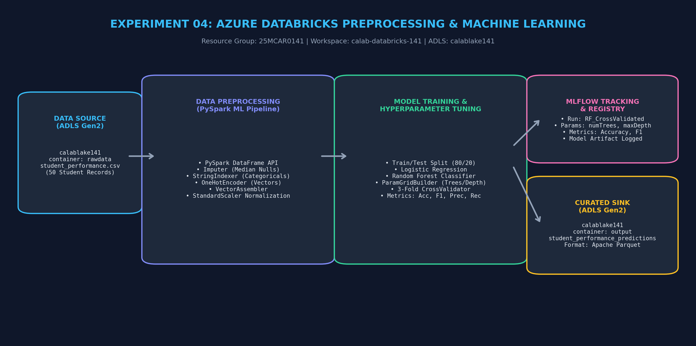
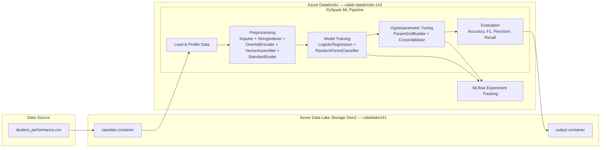

# Experiment 04: Azure Databricks for Data Preprocessing and Machine Learning

> **Course Outcome**: CO2  
> **Course**: Cloud Analytics (25MCAR0141)  
> **Target Document**: [CA_Exp04_Databricks_ML.pdf](CA_Exp04_Databricks_ML.pdf)

---

## Pipeline Communication & Architecture Diagram





---

## Aim & Objectives

- **Aim**: To use Azure Databricks for data preprocessing and machine learning by building a complete PySpark MLlib pipeline that cleans, transforms, and trains classification models on a student performance dataset with MLflow experiment tracking.
- **Objectives**:
  1. Perform data profiling and handle missing values using PySpark Imputer.
  2. Encode categorical features using StringIndexer and OneHotEncoder.
  3. Build a feature engineering pipeline with VectorAssembler and StandardScaler.
  4. Train and compare Logistic Regression and Random Forest classification models.
  5. Optimize model performance using ParamGridBuilder and CrossValidator.
  6. Log experiments, parameters, metrics, and models using MLflow.

---

## Architecture & Component Roles

| Component | Resource Name | Role / Description |
| :--- | :--- | :--- |
| **Resource Group** | `25MCAR0141` | Logical container for all Azure experiment resources |
| **Databricks Workspace** | `calab-databricks-141` | Apache Spark analytics platform running PySpark ML notebooks |
| **Storage Account** | `calablake141` | ADLS Gen2 hosting `rawdata` (input CSV) and `output` (Parquet predictions) |
| **MLflow** | Built-in (Databricks) | Experiment tracking: logs params, metrics, and trained model artifacts |
| **Compute Cluster** | Single-node (Standard_DS3_v2) | Cost-optimized Spark cluster for ML training |

---

## Step-by-Step Execution Summary

1. **Open Databricks Studio**: Navigate to `calab-databricks-141` workspace in Azure Portal → Launch Workspace (`adb-7405609713574305.5.azuredatabricks.net`).
2. **Create Compute Cluster**: Compute → Create Cluster → Name: `ml-cluster-141` → Single Node → Runtime: 14.3 LTS (Spark 3.5.0, Scala 2.12) → Standard_DS3_v2 → Auto-terminate: 20 min.
3. **Upload Dataset**: Upload `student_performance.csv` to DBFS via Databricks UI, or mount `calablake141/rawdata` container.
4. **Mount ADLS Gen2 Storage** (optional):
   ```python
   configs = {"fs.azure.account.key.calablake141.dfs.core.windows.net": "<STORAGE_KEY>"}
   dbutils.fs.mount(source="abfss://rawdata@calablake141.dfs.core.windows.net/",
                     mount_point="/mnt/rawdata", extra_configs=configs)
   ```
5. **Import Notebook**: Upload `Exp04_Databricks_Preprocessing_ML.py` as a Databricks notebook.
6. **Run Data Loading**: Execute Cell 1 — loads CSV, prints schema, displays data.
7. **Data Profiling**: Execute Cell 2 — summary statistics, null counts, class distribution.
8. **Preprocessing Pipeline**: Execute Cell 3 — Imputer, StringIndexer, OneHotEncoder, VectorAssembler, StandardScaler.
9. **Train/Test Split & Fit**: Execute Cell 4 — 80/20 split, fit pipeline.
10. **Train Models**: Execute Cell 5 — Logistic Regression + Random Forest training.
11. **Evaluation & Tuning**: Execute Cells 6-7 — metrics comparison, CrossValidator hyperparameter tuning.
12. **MLflow Logging**: Execute Cell 8 — log parameters, metrics, and model to MLflow.
13. **Feature Importance & Save**: Execute Cells 9-10 — visualize feature importances, save predictions to ADLS output.

---

## PySpark Code Highlights

### Preprocessing Pipeline
```python
preprocessing_pipeline = Pipeline(stages=[
    Imputer(strategy="median"),        # Handle missing numeric values
    StringIndexer(),                    # Encode categorical → numeric
    OneHotEncoder(),                    # One-hot encode indexed categories
    VectorAssembler(),                  # Combine all features into vector
    StandardScaler(withStd=True)        # Normalize feature scales
])
```

### Hyperparameter Tuning
```python
paramGrid = ParamGridBuilder() \
    .addGrid(rf.numTrees, [50, 100, 200]) \
    .addGrid(rf.maxDepth, [3, 5, 10]) \
    .build()
cv = CrossValidator(estimator=rf, estimatorParamMaps=paramGrid,
                    evaluator=evaluator_acc, numFolds=3)
```

### MLflow Logging
```python
with mlflow.start_run(run_name="RF_CrossValidated"):
    mlflow.log_param("numTrees", best_model.getNumTrees)
    mlflow.log_metric("accuracy", accuracy)
    mlflow.spark.log_model(best_model, "random_forest_model")
```

---

## Screenshot Checklist

Capture and save the following screenshots to the `Screenshots/` folder:

| # | Screenshot | Filename |
|---|---|---|
| 1 | Azure Portal — Resource Group `25MCAR0141` showing Databricks workspace | `Step_01_RG_Databricks_Overview.png` |
| 2 | Databricks Workspace Home page | `Step_02_Databricks_Workspace_Home.png` |
| 3 | Compute Cluster configuration (ml-cluster-141) | `Step_03_Cluster_Configuration.png` |
| 4 | Dataset loaded — `display(df)` output showing student records | `Step_04_Dataset_Loaded.png` |
| 5 | Null counts per column output | `Step_05_Null_Counts_Profiling.png` |
| 6 | Preprocessing pipeline stages printed | `Step_06_Pipeline_Stages.png` |
| 7 | Train/test split counts | `Step_07_Train_Test_Split.png` |
| 8 | Model evaluation metrics table (LR vs RF) | `Step_08_Model_Evaluation_Metrics.png` |
| 9 | CrossValidator best model accuracy | `Step_09_CrossValidator_Results.png` |
| 10 | MLflow experiment run logged | `Step_10_MLflow_Experiment_Run.png` |
| 11 | Feature importance bar chart | `Step_11_Feature_Importance.png` |
| 12 | Confusion matrix output | `Step_12_Confusion_Matrix.png` |
| 13 | Output Parquet files in ADLS Gen2 / DBFS | `Step_13_Output_Parquet_Files.png` |
| 14 | MLflow UI — Experiment details page | `Step_14_MLflow_UI_Details.png` |

---

## Lab Record PDF Document

The formal lab notebook report is available in:
**[CA_Exp04_Databricks_ML.pdf](CA_Exp04_Databricks_ML.pdf)**
