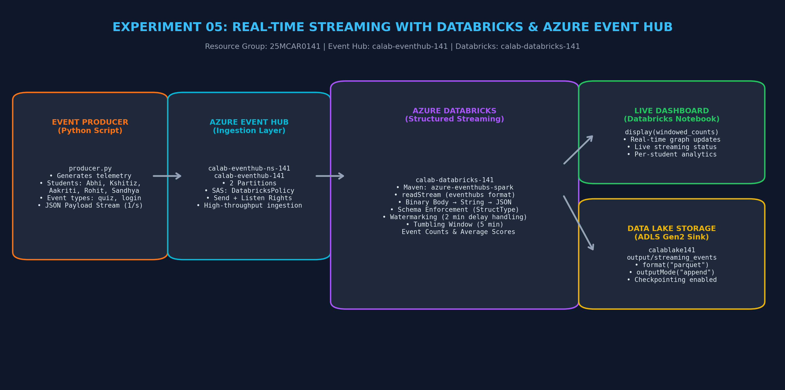
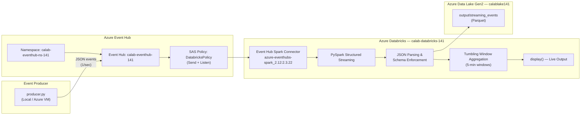

# Experiment 05: Real-Time Streaming Data Processing using Databricks & Azure Event Hub

> **Course Outcome**: CO3  
> **Course**: Cloud Analytics (25MCAR0141)  
> **Target Document**: [CA_Exp05_Streaming.pdf](CA_Exp05_Streaming.pdf)

---

## Pipeline Communication & Architecture Diagram





---

## Aim & Objectives

- **Aim**: To process real-time streaming data using Azure Databricks and Azure Event Hub by ingesting a live data stream, processing it using Structured Streaming in PySpark, and displaying the output in a Databricks notebook.
- **Objectives**:
  1. Create and configure an Azure Event Hub namespace and entity with SAS policies.
  2. Implement a Python producer script that simulates real-time student activity events.
  3. Read the stream in Azure Databricks using the Event Hub Spark connector.
  4. Parse JSON event payloads and apply schema enforcement.
  5. Perform tumbling window aggregations (event counts, average scores per student).
  6. Write streaming output to ADLS Gen2 in Parquet format with checkpointing.

---

## Architecture & Component Roles

| Component | Resource Name | Role / Description |
| :--- | :--- | :--- |
| **Resource Group** | `25MCAR0141` | Logical container for all Azure experiment resources |
| **Event Hub Namespace** | `calab-eventhub-ns-141` | Managed event ingestion service (Basic SKU, centralindia) |
| **Event Hub** | `calab-eventhub-141` | Event stream entity (2 partitions, 1-hour retention) |
| **SAS Policy** | `DatabricksPolicy` | Shared Access Policy with Send + Listen permissions |
| **Databricks Workspace** | `calab-databricks-141` | Spark analytics platform running Structured Streaming notebooks |
| **Storage Account** | `calablake141` | ADLS Gen2 — output sink for streaming Parquet files |

---

## Step-by-Step Execution Summary

1. **Create Event Hub Namespace**: Azure Portal → Event Hubs → Create Namespace `calab-eventhub-ns-141` in RG `25MCAR0141`.
2. **Create Event Hub Entity**: Inside namespace → + Event Hub → Name: `calab-eventhub-141`, Partitions: 2.
3. **Create SAS Policy**: Event Hub → Shared Access Policies → Add `DatabricksPolicy` with Send + Listen.
4. **Copy Connection String**: Copy the Primary Connection String from `DatabricksPolicy`.
5. **Open Databricks Studio**: Navigate to `calab-databricks-141` → Launch Workspace.
6. **Create Cluster**: Compute → Create Cluster → Single Node, Runtime 14.3 LTS, Standard_DS3_v2.
7. **Install Maven Library**: Cluster → Libraries → Install New → Maven → `com.microsoft.azure:azure-eventhubs-spark_2.12:2.3.22`.
8. **Import Streaming Notebook**: Upload `Exp05_Databricks_Streaming.py` → paste connection string.
9. **Run Producer Script**: Locally run `python producer.py` to send 50 student activity events.
10. **Start Streaming Notebook**: Run all cells — observe real-time events, windowed aggregations.
11. **Verify Output**: Check `calablake141/output/streaming_events` for Parquet files.
12. **Stop Stream & Terminate Cluster**: Stop streaming query, terminate cluster to save cost.

---

## Code Highlights

### Producer — Send Events to Event Hub
```python
from azure.eventhub import EventHubProducerClient, EventData
event = {"student_name": "Abhi", "event_type": "quiz_submit", "score": 85, ...}
producer.send_batch(event_data_batch)
```

### Consumer — Structured Streaming from Event Hub
```python
raw_stream = spark.readStream.format("eventhubs").options(**ehConf).load()
parsed = raw_stream.select(from_json(col("body").cast("string"), schema).alias("event"))
```

### Tumbling Window Aggregation
```python
windowed = parsed.withWatermark("enqueued_time", "2 minutes") \
    .groupBy(window("enqueued_time", "5 minutes"), "student_name") \
    .agg(count("*").alias("event_count"), avg("score").alias("avg_score"))
```

---

## Screenshot Checklist

| # | Screenshot | Filename |
|---|---|---|
| 1 | Azure Portal — Event Hub Namespace overview | `Step_01_EventHub_Namespace_Overview.png` |
| 2 | Event Hub entity `calab-eventhub-141` details | `Step_02_EventHub_Entity_Details.png` |
| 3 | SAS Policy `DatabricksPolicy` with keys | `Step_03_SAS_Policy_Keys.png` |
| 4 | Databricks Cluster with Maven library installed | `Step_04_Cluster_Maven_Library.png` |
| 5 | Producer script running — terminal output showing events sent | `Step_05_Producer_Script_Running.png` |
| 6 | Raw streaming events displayed in notebook | `Step_06_Raw_Streaming_Events.png` |
| 7 | Parsed JSON stream with student names and event types | `Step_07_Parsed_JSON_Stream.png` |
| 8 | Tumbling window aggregation — events per student | `Step_08_Windowed_Aggregation.png` |
| 9 | Event type distribution streaming chart | `Step_09_Event_Type_Distribution.png` |
| 10 | Streaming query status (active) | `Step_10_Streaming_Query_Status.png` |
| 11 | Output Parquet files in ADLS Gen2 | `Step_11_Output_Parquet_ADLS.png` |

---

## Lab Record PDF Document

The formal lab notebook report is available in:
**[CA_Exp05_Streaming.pdf](CA_Exp05_Streaming.pdf)**
