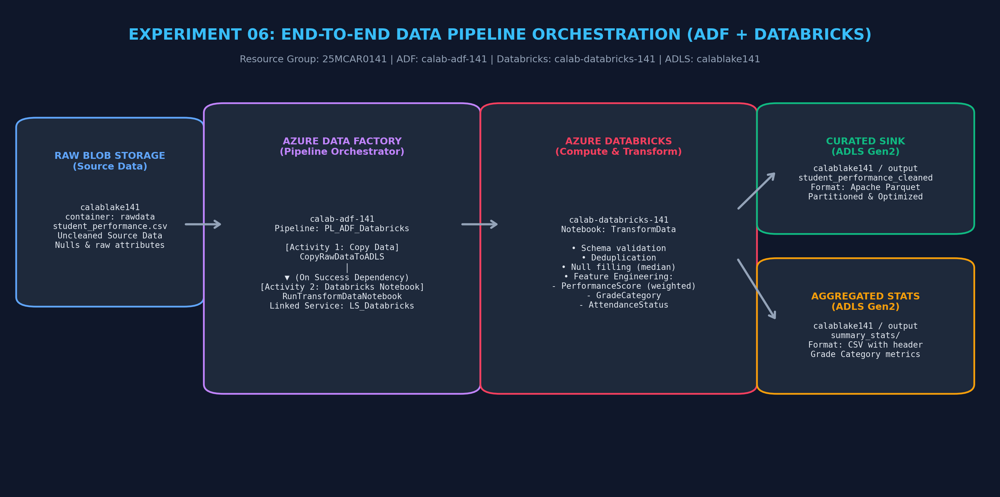
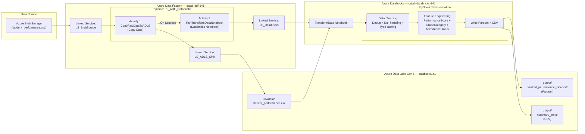

# Experiment 06: End-to-End Data Pipeline Orchestration using Azure Data Factory and Azure Databricks

> **Course Outcome**: CO3  
> **Course**: Cloud Analytics (25MCAR0141)  
> **Target Document**: [CA_Exp06_ADF_Databricks.pdf](CA_Exp06_ADF_Databricks.pdf)

---

## Pipeline Communication & Architecture Diagram





---

## Aim & Objectives

- **Aim**: To integrate Azure Data Factory with Azure Databricks for end-to-end data pipeline orchestration, where ADF triggers a Databricks notebook to preprocess and transform data ingested from Azure Data Lake Storage Gen2.
- **Objectives**:
  1. Create ADF Linked Services for Blob Storage, ADLS Gen2, and Azure Databricks.
  2. Build an ADF pipeline with Copy Data activity followed by Databricks Notebook activity.
  3. Configure success-dependency chaining between pipeline activities.
  4. Implement PySpark data cleaning and feature engineering in a Databricks notebook.
  5. Validate the transformed Parquet output in ADLS Gen2.
  6. Monitor pipeline runs and activity status in ADF Studio.

---

## Architecture & Component Roles

| Component | Resource Name | Role / Description |
| :--- | :--- | :--- |
| **Resource Group** | `25MCAR0141` | Logical container for all Azure experiment resources |
| **Data Factory** | `calab-adf-141` | Cloud data orchestration engine executing the ELT pipeline |
| **Storage Account** | `calablake141` | ADLS Gen2 hosting `rawdata` (input) and `output` (transformed) containers |
| **Databricks Workspace** | `calab-databricks-141` | Apache Spark platform executing the TransformData notebook |
| **Linked Service** | `LS_Databricks` | ADF ↔ Databricks connection (MSI auth, job cluster) |
| **Pipeline** | `PL_ADF_Databricks` | Orchestrates Copy Data → Databricks Notebook activities |

---

## Step-by-Step Execution Summary

1. **Open ADF Studio**: Azure Portal → `calab-adf-141` → Launch Studio.
2. **Create Linked Service — Blob Storage**: Manage → Linked Services → + New → Azure Blob Storage → name `LS_BlobSource` → select `calablake141`.
3. **Create Linked Service — ADLS Gen2**: + New → Azure Data Lake Storage Gen2 → name `LS_ADLS_Sink` → select `calablake141`.
4. **Create Linked Service — Databricks**: + New → Azure Databricks → name `LS_Databricks` → workspace URL: `adb-7405609713574305.5.azuredatabricks.net` → New job cluster → Runtime 14.3, Standard_DS3_v2, 1 worker.
5. **Create Source Dataset**: Author → Datasets → + New → DelimitedText → name `DS_BlobSource_CSV` → linked service `LS_BlobSource` → file `student_performance.csv`.
6. **Create Sink Dataset**: + New → DelimitedText → name `DS_ADLS_Sink_CSV` → linked service `LS_ADLS_Sink` → container `rawdata`.
7. **Upload TransformData Notebook**: In Databricks Studio, import `TransformData.py` as a notebook.
8. **Create Pipeline**: Author → Pipelines → + New → name `PL_ADF_Databricks`.
9. **Add Copy Data Activity**: Drag Copy Data → Source: `DS_BlobSource_CSV` → Sink: `DS_ADLS_Sink_CSV`.
10. **Add Databricks Notebook Activity**: Drag Databricks Notebook → connect after Copy Data (success dependency) → select `LS_Databricks` → browse notebook `/Users/.../TransformData`.
11. **Validate & Publish**: Click Validate → Publish All.
12. **Trigger Pipeline**: Add Trigger → Trigger Now → run the pipeline.
13. **Monitor & Verify**: Monitor → Pipeline Runs → verify both activities show `Succeeded`. Check `calablake141/output/student_performance_cleaned` for Parquet files.

---

## ADF Pipeline Definition

The pipeline JSON definitions are available in:
- **Pipeline**: [`pipeline/PL_ADF_Databricks.json`](pipeline/PL_ADF_Databricks.json)
- **Linked Service**: [`linkedService/LS_Databricks.json`](linkedService/LS_Databricks.json)

### Pipeline Activity Chain
```
CopyRawDataToADLS (Copy Data)
    │
    ├── Source: DS_BlobSource_CSV (Blob Storage)
    ├── Sink:   DS_ADLS_Sink_CSV (ADLS Gen2 rawdata)
    │
    └── On Success ──→ RunTransformDataNotebook (Databricks Notebook)
                            │
                            ├── Linked Service: LS_Databricks
                            ├── Notebook: /Users/.../TransformData
                            └── Output: ADLS Gen2 output/ (Parquet + CSV)
```

---

## Screenshot Checklist

| # | Screenshot | Filename |
|---|---|---|
| 1 | ADF Studio — Linked Services list (LS_BlobSource, LS_ADLS_Sink, LS_Databricks) | `Step_01_ADF_Linked_Services.png` |
| 2 | LS_Databricks configuration (workspace URL, cluster config) | `Step_02_LS_Databricks_Config.png` |
| 3 | Dataset DS_BlobSource_CSV configuration | `Step_03_Dataset_Source_Config.png` |
| 4 | Pipeline canvas — Copy Data → Databricks Notebook chain | `Step_04_Pipeline_Canvas.png` |
| 5 | Copy Data activity settings (source & sink) | `Step_05_Copy_Activity_Settings.png` |
| 6 | Databricks Notebook activity settings (notebook path) | `Step_06_Notebook_Activity_Settings.png` |
| 7 | Pipeline validation — no errors | `Step_07_Pipeline_Validation.png` |
| 8 | Trigger Now — pipeline triggered | `Step_08_Pipeline_Triggered.png` |
| 9 | Monitor — Pipeline run succeeded (both activities green) | `Step_09_Pipeline_Run_Succeeded.png` |
| 10 | Copy Data activity run details | `Step_10_Copy_Activity_Run_Details.png` |
| 11 | Databricks Notebook activity run details (with output) | `Step_11_Notebook_Activity_Output.png` |
| 12 | ADLS Gen2 — rawdata container with uploaded CSV | `Step_12_ADLS_Rawdata_Container.png` |
| 13 | ADLS Gen2 — output/student_performance_cleaned Parquet files | `Step_13_ADLS_Output_Parquet.png` |
| 14 | Databricks notebook — TransformData output display | `Step_14_Databricks_TransformData_Output.png` |

---

## Lab Record PDF Document

The formal lab notebook report is available in:
**[CA_Exp06_ADF_Databricks.pdf](CA_Exp06_ADF_Databricks.pdf)**
