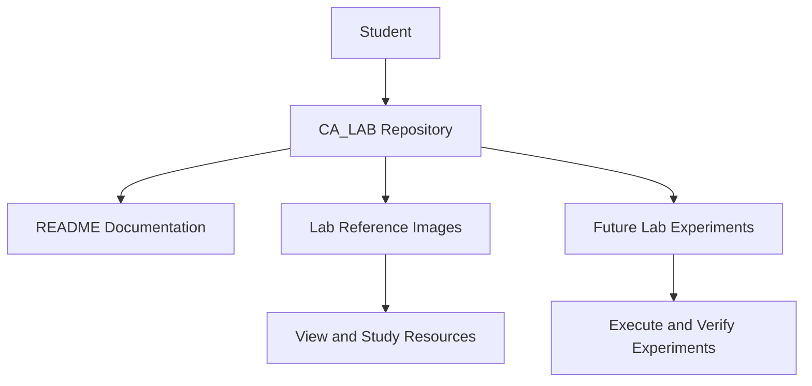

# CA_LAB

A repository for Computer Architecture Lab resources and reference materials.

## Overview

CA_LAB contains image-based lab resources and reference materials. This repository can be extended with experiment descriptions, source code, outputs, and practical documentation.

## Architecture



## Project Structure

```text
CA_LAB/
├── README.md
├── img1.png
├── img2.png
├── img3.jpeg
├── img4.jpeg
├── img5.jpeg
└── img6.png
```

## Getting Started

### 1. Clone the Repository

```bash
git clone https://github.com/Anshumaankhare2403/CA_LAB.git
```

### 2. Open the Project

```bash
cd CA_LAB
```

### 3. View the Resources

Open the image files in your preferred image viewer or IDE.

## Technologies and Tools

- Git — Version control
- GitHub — Repository hosting
- Markdown — Documentation

## Future Improvements

- Add individual lab experiment descriptions.
- Include objectives, algorithms, and procedures.
- Add source code and sample outputs where applicable.
- Document experiment results and observations.
- Organize resources into separate folders by experiment.

## Contributing

1. Fork the repository.
2. Create a new branch.
3. Add your changes.
4. Commit and push your changes.
5. Open a pull request.

## Author

**Anshumaan Khare**

GitHub: [@Anshumaankhare2403](https://github.com/Anshumaankhare2403)

## License

No license has been specified yet. Add a license file if you intend to distribute this repository under an open-source license.
